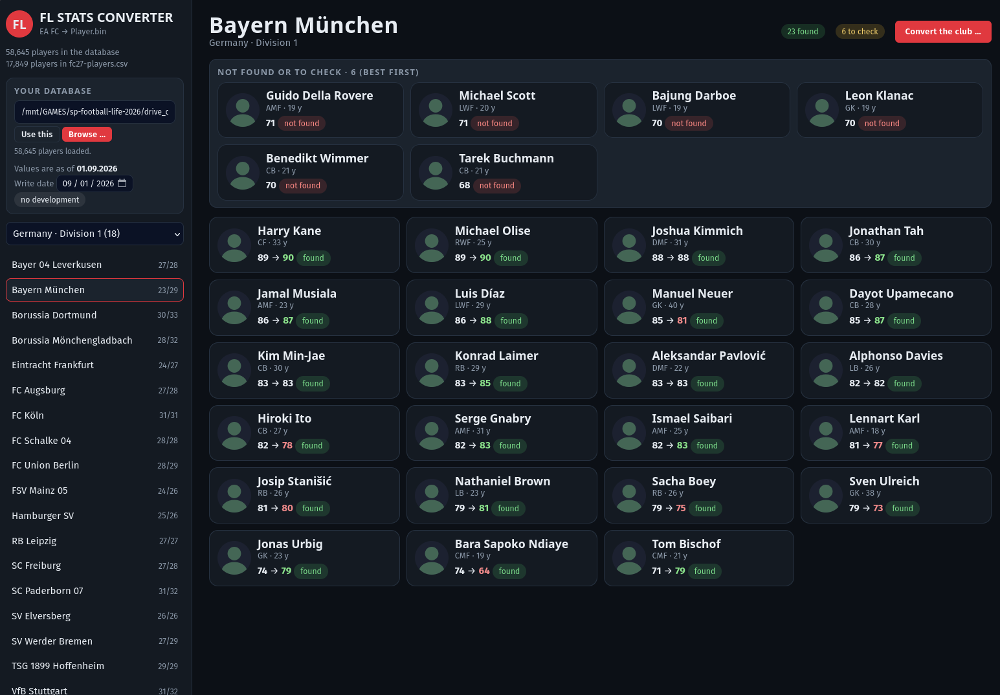
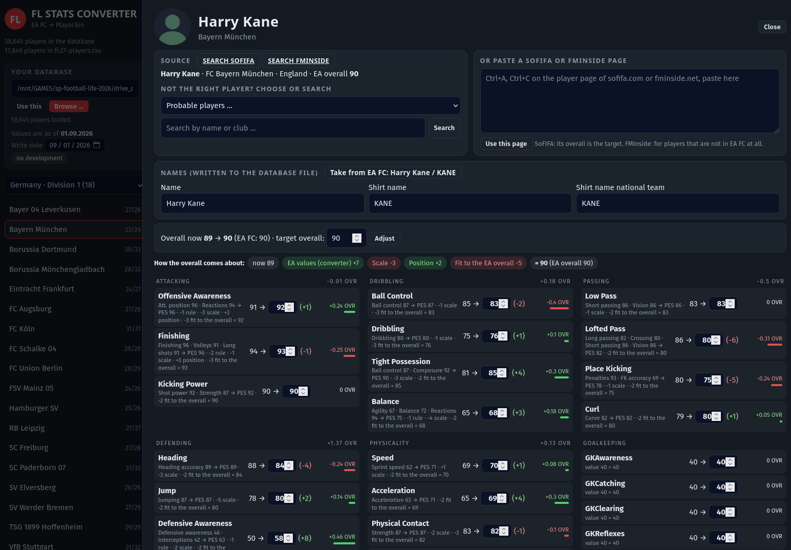
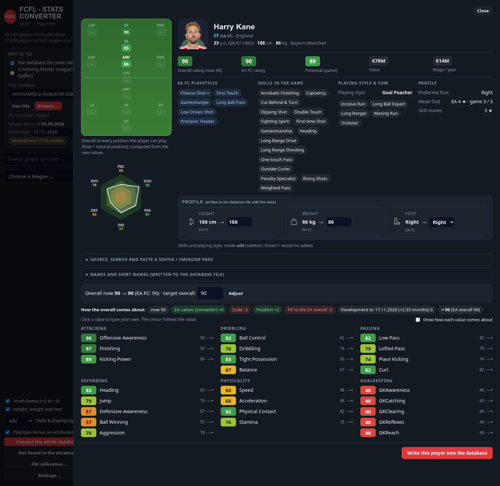

# FCFL - Stats Converter

Converts **EA SPORTS FC** player stats (and pages of **FMInside** / **SoFIFA**) into the player database of
**Football Life** (`Player.bin`, the 25 attributes of PES 21 / eFootball): for **one player, a club, a league or the whole database**,
with a **backup before every write**, a check afterwards and a one-click restore.

You choose the path to your `Player.bin`, the tool compares your database with the EA FC data that comes with it,
shows what would change (every attribute, old → new, with the reason) and offers to write it. No other tool is needed.

> Deutsche Anleitung: [README.de.md](README.de.md)

See [CHANGELOG.md](CHANGELOG.md) for what changed in every release.

## What is in it

* **Update the active database with EA FC stats** – the main purpose. League, club, player or the whole database, found automatically in the EA FC data that comes with the tool.
* **Manual converter for SoFIFA and FMInside** – open the player page, select everything (Ctrl+A), copy (Ctrl+C), paste it into the tool: it converts the values (SoFIFA) or the Football Manager attributes (FMInside) to the game.
  Search buttons for both sites are on every player.
* **Manual adjustments** – set the overall you want for a player (the attributes are moved to match), change single attributes, change names and shirt names.
* **Height, weight and preferred foot** of the EA FC entry are written with the stats (switch in the sidebar), each with an icon in the profile card of the player, and you can type your own values.
* **Skills, COM playing styles and playing style** from the EA FC PlayStyles of a player (experimental, switch in the sidebar: off / add / replace), by the mapping in [docs/PLAYSTYLE_MAPPING.md](docs/PLAYSTYLE_MAPPING.md): a skill is only given when EA FC has the PlayStyle **and** the player's values make it safe ([docs/SKILL_TRANSLATION.md](docs/SKILL_TRANSLATION.md), with the measured quality). A switch *PlayStyle bonus on attributes* gives PlayStyles that PES can only show through values +1 / +2 on the attributes (the overall stays). The player window shows what he has now and what would be added.
* **Positions and traits for players without EA data:** players that are new in the game or come from a pasted page get skills, playing style and positions from their own values and position, with models fitted on the players of the game ([docs/PES_TRAITS_PROFILE.md](docs/PES_TRAITS_PROFILE.md), [docs/POSITIONS.md](docs/POSITIONS.md)). The positions of EA FC players get their alternative positions.
* **Writing into a running Master League** (optional, needs **Gaffer**): the 25 attributes are sent to the game through Gaffer's bridge, in packages with a progress bar. See below.
* **Search** for players and teams in the sidebar (no need to go through the league menu): type two letters, click a team to open it, a player to open him.
* Photos and club logos from Gaffer, when it runs (a placeholder otherwise). Starting the tool a second time just opens the page of the running one.
* Folder picker, backups with one-click restore, players that are already converted are marked and skipped.

**Planned:** positions, weak foot, attribute bonuses of PlayStyle+ and more.





More: [a league club](docs/screenshots/club-3-liga.png) · [another club](docs/screenshots/club-molde.png) · [another player](docs/screenshots/player-tomas-jacob.png)

## Start

You need Python 3.9 or newer (nothing else, the tool uses only the standard library) **or** a download from the *Releases* page
(`fcfl-stats-converter-windows.exe`, `fcfl-stats-converter-linux`).

```
python3 flconv/server.py        # Linux / macOS     (or ./start.sh)
py flconv\server.py             # Windows           (or start.bat)
```

The tool opens `http://127.0.0.1:8790/` in your browser (it only listens on your own computer).

1. Enter the path of your `Player.bin` in the box *Your database* (the folder that contains it, a folder above it, or the file itself).
   For Football Life that is the folder `pesdb`, e.g. `…/livecpk/_FL26MyWorld/common/etc/pesdb`.
2. Choose a league, then a club. Players that are found in the EA FC data are shown with `old overall → new overall`.
3. Open a player to see every attribute with its reason, change values or names by hand, or use *Convert the club* / *Convert the whole database*.
4. Close the game while you write. Start a **new career** to see the new values.

Settings, backups and the copy of your original `Player.bin` are kept in `~/.local/share/fl-stats-converter` (Linux) or
`%APPDATA%\FL-Stats-Converter` (Windows); `--data-dir` changes that.

## The new SoFIFA base export (German, with contracts, values, loans)

The standard database can be the **German SoFIFA export of all players** (`sofifa-alle-2026-11-24.csv`: `ID;Name;Vollständiger Name;…;Spielstile;Spielstile+;Antritts-Typ;Emotion;Growth profile;…`). Put it into the folder `ea-base` of the data folder: the newest file there (by the date in its name) is the base, no restart. The converter reads from it, besides the 34 attribute values, rating and **potential**:

* **PlayStyles** (*Spielstile* and *Spielstile+*) translated with the table of EA FC 27 (`flconv/data/playstyles_de.json`, 36 PlayStyles; *Harter Pass* = Whipped Pass, *Schnittstellenpass* = Pinged Pass, *Durchsetzungskraft* = Enforcer, …); a name that is not in the table is never guessed, it is left out and reported. Answered by you: *Trivela*, *Flair*, *Power-Kopfball* (Power Header), *In der Luft* (Aerial) and *1-gg-1 Zumachen* are mapped; *Führungsstärke* gives the skill Captaincy; the CPU AI traits *Distanzsch.* / *Frühes Flanken* give the COM styles Long Ranger / Early Cross when the values fit; *Vereinstreue Spielerin*, *Teamspielerin*, *Zuverlässigkeit*, *Anfällig für Verletzungen* and *Harte Flanke* stay out.
* **Growth profile**: it scales the youth bonus (Explosive Start x1.3, Meteoric Peak x1.15, Late Bloomer x0.7, the rest x1.0); with the potential of the new base every young player has a bonus, not only those the old export had a potential for.
* **Emotion**, **acceleration type** (*Antritts-Typ*), work rates, contract, **loan** (*Leihe*: the club he belongs to, until when), value, wage, release clause: shown on the player page (value and wage as tiles). A loaned player is also found by the club he belongs to.
* The potential is not a field of `Player.bin` (no bit of the 312 byte record follows it: the best correlation is the age). It stays in the tool: it is used for the youth bonus, shown, and kept in the journal with every player that is written.

## SoFIFA updates (new player values, loaded live)

SoFIFA sends CSV files with updated player values: the EA FC export (the columns of `fc27-players.csv`) or the **German SoFIFA export** (`ID;Name;Vollständiger Name;…;Gesamtbewertung;…`, as `sofifa-updates-270007-2026-11-24.csv`; the date is read from the file name). From the German export the rating, potential, club, nation, positions, height, weight, foot, weak foot and the 34 attribute values are taken over; the PlayStyles stay those of the standard database (their German names are not translated). **Tools > SoFIFA update** loads one or several of them, or you copy them into the folder `ea-updates` of the data folder; the tool picks them up within 10 seconds, no restart. For every player the **newest row** counts: a row with a newer snapshot (the `snapshot` column; else the date in the file name, else the day the file was changed) replaces an older update and the standard database, an older row never replaces a newer one, players that the standard database does not have are added. Eight updates in any order are fine. The start page lists every update with its date and how many players it supplies; the player page says "EA FC rating (SoFIFA update 24.11.2026)", and a player whose values changed shows *convert again*.

## FM list (FMInside export) as fallback and filler

The converter ships a list exported from FMInside (`flconv/data/fmdb/`, CSV, `;`, first column `UID`, one row per player, about 10,000 players of which about 6,000 with all values). Your own, newer lists go into the folder `fmdb` of the data folder (`~/.local/share/fl-stats-converter/fmdb/` on Linux; several files are fine, your files win over the shipped one by UID). The converter uses them like this:

* **Fallback source:** a player that EA FC / SoFIFA does not have (no match) is converted from the list, like a pasted FMInside page (with the calibration below). An uncertain EA match is not replaced, you choose it as before.
* **Positions come from FM first:** a player with position ratings in the list gets exactly those (*natural* = level 2, *accomplished* = 1, everything else 0; the second striker has no FM rating and stays; his main position stays at level 2). EA FC (alternative positions) and the values model are the fallback for players without FM ratings. A row that does not fit the player's position (a keeper called like a striker) is not used. In the player list a chip says *Found EAFC*, *Found FM* or *Found EAFC & FM*.
* **Fills what EA FC does not give:** the **weak foot** (use and accuracy, written into `Player.bin`; FM 2 / 3 / 4 gives 2/2, 2/3, 3/3, fitted on 51 players of the game), preferred foot and height where EA FC has none.
* **Calibration:** the FM conversion is moved to the level of the EA FC conversion per attribute (checked on players that were not used for the fit, 20 % held out of 2,900: field players 5.7 → 4.3 points off the EA FC conversion, keepers 5.6 → 1.7; the ship has a thinned set of 300 samples, the full set stays on your machine; keepers have their own fit). A list can be pasted into the *FM calibration* box like page text to add samples.

## Loading changes into the running game (PESM-LivePatch, no restart)

When the converter writes `Player.bin` (attributes) or a line-up, it also writes small patch files into `<Sider>/content/pesm-livepatch/` and ships the Sider module
**PESM-LivePatch** (`flconv/data/pesm-livepatch.lua`, copied to `<Sider>/modules/` at the first write). The database folder has to be below `<Sider>/livecpk/`.

1. Once: at the first start of this version the converter asks (notice at the bottom right) whether to set it up: after your OK it copies the module and adds `lua.module = "pesm-livepatch.lua"` to `sider.ini` (a backup of `sider.ini` is made first). Restart the game once.
2. Change and write in the converter (or in PESM, which uses the same files).
3. In the game's main menu open the Sider overlay (Space), choose **PESM-LivePatch** (key `1`), press **F7**.
4. Close the overlay and start your match as usual: the new line-up, shirt numbers and attribute values are there, no restart.

What goes live: the 25 attributes, squad order (line-up), shirt numbers, formations. What needs a restart: skills, COM styles, positions, names, new or moved players.
How it works: the game keeps its tables as converted copies in memory (no copy of the files), the module finds them and writes only what differs, and only after a check
(right table size, same players in the squad). The layout of the team objects was found with memory dumps (`tools/dev/`), see `flconv/livepatch.py`.

## Writing into a running Master League (needs Gaffer)

By default the tool writes `Player.bin` (for new careers). To change a career that is already running you need **Gaffer** (a separate tool; its bridge is the way into the running game):
choose *a running Master League* under *Write to*, and the folder of Gaffer's bridge (the one with `growth.csv`; the tool looks for `…/content/ml-immersion/bridge` next to your database).
The game has to run in the Master League and F7 has to be pressed once (Gaffer's module). Then:
* the converter ships its own adapted `GrowthBridge.lua` (`flconv/data/`); you give the Sider `modules` folder once, at every start it is compared with the one there and replaced if it differs (the old one is kept in the data folder, `moved/`). Restart the game once after a replacement;
* the 25 attributes and, when *Profile* / *Skills* are on, **skills, COM styles, playing style and positions** are sent plus height, weight and foot (not names), and only values that differ from the running game. The profile needs the updated `GrowthBridge.lua` module (from this repository's notes: version 1.3 with the fields `B<bit>`, `P<bit>`, `Style`, `Height`, `Weight`, `Foot`); restart the game once after replacing it;
* writes of more than 20,000 values go **in packages**: the next one is sent when the game has answered the last, the progress is shown, and you can cancel the rest;
* the write date is the date of the game, and the players of the clubs are the ones of your save (transfers included).

## What it does with a player

1. **Finds the player in the EA FC data.** The full name has to match first; if there are namesakes the tool narrows them down by year of birth
   (compared with the age in your database), height, nation and club, and looks at the overall last (clubs and overalls differ between
   the game and the export, players move). Anything it is not sure about is shown for you to decide, and what you decide is remembered.
   The search box and the paste field cover players who are not in the data.
2. **Converts the values** with the formulas of the *PES Stats Converter* (see [CHANGES.md](CHANGES.md) for everything that was changed or added),
   moves them to the scale of Football Life, balances them by position, uses a keeper model for goalkeepers and fits the result to the overall of the source.
3. **Youth bonus** (optional): +1 to +3 overall for young players whose potential is far above their rating (needs a potential, from a SoFIFA page).
4. **Development** to a date you choose: the EA data is from 01.09.2026; if your career is further on, young players grow and old ones decline by a model.
5. Writes `Player.bin`: **backup first**, write, read again and compare, on any difference the backup is put back.

The conversion always starts from the **original** values (a copy of your `Player.bin` is made the first time you use a database), so running it twice
gives the same result and never scales players down again.
If your `Player.bin` was already changed by another tool when you start, that changed file counts as the original; keep your own backup.

## Data

`flconv/data/fc27-players.csv` is a data set of EA SPORTS FC 27 ratings (17,849 male players, snapshot 12 Sep 2026). **Sources and licenses:** [DATA.md](DATA.md).
You can use another export with `--csv file.csv` (same columns, see DATA.md).

## Notes

* Developed and tested on **Linux** with the database of Football Life 2027. Windows should work (pure Python), but it was not tested there.
* The layout of `Player.bin` (WESYS container, 312 byte records, attribute bit fields) was found by comparing the file with the in-game table of the same database.
  Other databases or versions can differ: the tool checks the file when it reads it, refuses what it does not understand and always makes a backup, but try it on a copy first.
* This is a fan tool. It is not affiliated with or endorsed by EA, Konami, Sports Interactive, SoFIFA, FMInside or the Football Life team.
  All names and trademarks belong to their owners.

## License

GPL-3.0, see [LICENSE](LICENSE). The conversion formulas are derived from the *PES Stats Converter* by moth1995 (GPL-3.0), see [CHANGES.md](CHANGES.md).

## Line-up from Sofascore (database mode)
Club view -> *Line-up from Sofascore*: reads the last finished match of the club (unofficial Sofascore JSON through `curl`, throttled, cached in the data folder `sofa/`), shows the eleven, the bench and the shirt numbers and writes
them into `PlayerAssignment.bin` (order and number in `k`; backup in `moved/`, read back and checked). The formation itself is not written. Sofascore does not promise this access: if it stops, only `flconv/sofa.py` has to change.

## Performance since the date of the data (database and Master League)
Club view -> *Performance since 01.09.*: how a player did since the date of the data changes a few of his values, a little. Switch: *Conversion options -> Live data (performance)*.

**Data.** For every finished match since 01.09.2026 Sofascore gives, per player, the minutes, the rating (0-10) and its own values for passing, dribbling, defending, shooting and goalkeeping
(0 = as expected for the position). Rating and values are averaged weighted by minutes.

**Who counts.** At least 3 matches and 270 minutes. The weight grows with playing time: `w = min(1, minutes / 900)`.

**Against the team.** Ratings of different teams and leagues are not comparable, so everything is measured against the team: `perf = rating - team rating - 0.04 x (overall - team overall)`
(better players are expected to rate a bit higher), and every aspect value is taken minus the team mean of that aspect. So roughly as many players go up as down, and only clear over- and
underperformers change.

**Which values move.** `change = round(w x (2.5 x aspect + perf))`, at most 3 per value, only on the attributes of that aspect:
passing -> Low Pass, Lofted Pass; dribbling -> Dribbling, Ball Control, Tight Possession; defending -> Defensive Awareness, Ball Winning; shooting -> Finishing, Offensive Awareness;
goalkeeping (keepers only) -> GK Awareness, Catching, Reflexes. Better than the team: up, worse: down.

**Development by time is weighted by the performance.** The time shift (age curve, e.g. +2.5 months) is only an expectation. With Sofascore data the performance says whether he *confirms* it, *overperforms* or
*underperforms* his values (`z = perf / 0.5`, limited to -1..+1): the time development counts `x (1 + 0.5 x w x z)` for a player who still grows and `x (1 - 0.5 x w x z)` for one who declines. A growing player who
overperforms grows more (up to x1.5), one who underperforms less (down to x0.5); a declining player who overperforms declines less, one who underperforms declines more. Confirming his values (z near 0) changes nothing.
The player panel says which of the three it is and what the time development counts.

**The overall hardly moves.** If the overall of the position model would change by more than 2, all changes are scaled down until it changes by 2 at most. In practice: about one player in four
changes, mostly by 1 per value and 0 or +-1 overall (7 clubs checked: 36 of about 160 players, no overall change above 1).

Example: Michael Olise (Bayern), 13 matches, 1,065 minutes, rating 8.42 against a team rating of 7.34: Low Pass +2, Lofted Pass +2, Dribbling +2, Ball Control +2, Tight Possession +2, Defensive Awareness +1,
Ball Winning +1, Finishing +1, Offensive Awareness +1, overall +1. It is applied as development on top of the time shift when the player is converted (the player panel shows every step).

## Browser button for SoFIFA and FMInside (Tampermonkey)
Instead of Ctrl+A, Ctrl+C and pasting: install `userscript/fcfl-send-player.user.js` in Tampermonkey (or Violentmonkey). On a player page of sofifa.com or fminside.net a red **-> FCFL** button appears.
It sends the page to the running converter (`127.0.0.1:8790`, change `FCFL` at the top of the script if you use another port) and opens the converter, which finds the player in your database by name and
shows the conversion of the page; one click writes it. If several players have the name, you pick the right one. Nothing leaves your computer except the request to your own converter.
